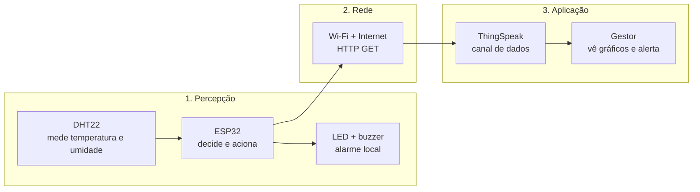

# 🌡️ Monitor do Depósito — Desafio Final IoT


-blue)

> Um ESP32 que vigia o depósito do Grupo Pleno: mede temperatura e umidade, acende um alarme no local quando esquenta demais e avisa o gestor pela internet.

**Projeto:** Desafio Final de IoT · Faculdade Senac
**Caminho escolhido:** A / HTTP no ThingSpeak
**Limite de temperatura:** 30 °C

---

## 📌 Índice

1. [O problema](#-o-problema)
2. [Como funciona](#-como-funciona)
3. [Hardware e ligações](#-hardware-e-ligações)
4. [Requisitos atendidos](#-requisitos-atendidos)
5. [Passo a passo para rodar](#-passo-a-passo-para-rodar)
6. [Testes](#-testes)
7. [Demonstração](#-demonstração)
8. [Segurança](#-segurança)
9. [Estrutura do repositório](#-estrutura-do-repositório)

---

## 🎯 O problema

Os equipamentos de som e luz do Grupo Pleno ficam guardados em um depósito que esquenta e acumula umidade, o que danifica o material. Ninguém fica lá para conferir.

**Pergunta norteadora:** como o gestor fica sabendo, de casa, que o depósito está quente demais?

**Resposta deste projeto:** o ESP32 mede o ambiente, liga um alarme no local e envia os dados e o alerta para o ThingSpeak, onde o gestor acompanha tudo pela internet.

---

## 🧠 Como funciona

O dado percorre três camadas, do sensor até o gestor:



**Lógica do alarme (com histerese):**

- Alarme desligado e temperatura **acima de 30 °C** → liga LED e buzzer.
- Alarme ligado e temperatura **abaixo de 29 °C** (limite − 1) → desliga.
- Entre 29 °C e 30 °C o alarme **mantém o estado atual**. Isso evita que o LED fique ligando e desligando quando a temperatura oscila perto do limite.

---

## 🔌 Hardware e ligações

| Componente | Pino do ESP32 | Observação |
|---|---|---|
| Sensor DHT22 | GPIO 15 (SDA) | VCC no 3V3 e GND no GND |
| LED vermelho | GPIO 2 | com resistor de 220 Ω |
| Buzzer | GPIO 4 | apita com `tone()` |

O circuito completo está no arquivo `diagram.json`.

---

## ✅ Requisitos atendidos

| Requisito | O que faz | Como foi feito |
|---|---|---|
| **RF1 · Medir** | Lê temperatura e umidade a cada 2 s e ignora leituras inválidas | `dht.getStatus() == ERROR_NONE` |
| **RF2 · Alarme local** | Liga acima do limite e só desliga abaixo de limite − 1 | função `decidirAlarme()` |
| **RF3 · Enviar os dados** | Envia temperatura (field1) e umidade (field2) a cada 20 s | `ThingSpeak.writeFields()` com código 200 |
| **RF4 · Avisar o gestor** | Com o alarme ligado, envia o alerta no mesmo envio | `field3 = 1` e status `ALERTA` |

---

## 🚀 Passo a passo para rodar

### 1. Crie o canal no ThingSpeak
1. Entre em [thingspeak.com](https://thingspeak.com) logue e crie um canal novo.
2. Ative três campos: **Field 1 = Temperatura**, **Field 2 = Umidade**, **Field 3 = Alarme**.
3. Anote o **Channel ID**.
4. Na aba **API Keys**, copie a **Write API Key**.
5. Lembre-se de ajustar sua view.

### 2. Monte o projeto no Wokwi
1. Abra [wokwi.com](https://wokwi.com) e crie um projeto **ESP32**.
2. Substitua o conteúdo dos arquivos do projeto pelos deste repositório: `sketch.ino`, `diagram.json` e `libraries.txt`.
3. Confira se as bibliotecas **DHT sensor library for ESPx** e **ThingSpeak** estão no projeto.

### 3. Configure suas credenciais
No início do `sketch.ino`, troque os três valores de exemplo do bloco de configuração:

```cpp
const char*   MATRICULA     = "SUA_MATRICULA";   // sua matrícula
unsigned long CANAL_ID      = SEU_ID;            // número do seu canal (só números)
const char*   CHAVE_ESCRITA = "SUA_CHAVE";       // sua Write API Key
```

> ⚠️ O código só compila depois de trocar o `SEU_ID` pelo número do seu canal.

### 4. Rode a simulação
1. Clique em **Play** no Wokwi.
2. Abra o **monitor serial** e espere a conexão com o Wi-Fi.
3. A cada 20 s deve aparecer uma linha como esta:

```
COMPROVANTE A2 | mat=SUA_MATRICULA | limite=30 | canal=SEU_CANAL | intervalo=20s | HTTP=200
```

O **HTTP=200** mostra que o ThingSpeak recebeu e aceitou o envio.

---

## 🧪 Testes

Para mudar a temperatura, clique no DHT22 durante a simulação.

| Teste | O que fazer | O que deve acontecer |
|---|---|---|
| **T1 · Normal** | Deixar abaixo de 30 °C | Dados chegam ao ThingSpeak e o LED fica apagado |
| **T2 · Alarme** | Subir acima de 30 °C | LED e buzzer ligam, e o alerta (field3 = 1) chega à nuvem |
| **T3 · Volta ao normal** | Baixar abaixo de 29 °C | O LED apaga |

> 💡 O alerta só chega à nuvem no próximo envio (a cada 20 s) que acontecer com o alarme ainda ligado.

---

## 📺 Demonstração

- 🧩 **Projeto no Wokwi: https://wokwi.com/projects/480082459552128001

---

## 🔐 Segurança

- Este repositório é **público**, por isso a Write API Key **não** está no código: o valor é `"SUA_CHAVE"`.
- Use sua chave real só para testar e **nunca a envie para o GitHub**.
- Se uma chave real for publicada por engano, gere uma nova no ThingSpeak (**API Keys → Generate New Write API Key**), porque a antiga continua visível no histórico do repositório.

---

## 📂 Estrutura do repositório

```
├── sketch.ino          # código do ESP32
├── diagram.json        # circuito do Wokwi
├── libraries.txt       # bibliotecas usadas
├── wokwi-project.txt   # referência ao projeto no Wokwi
└── README.md           # este guia
```
